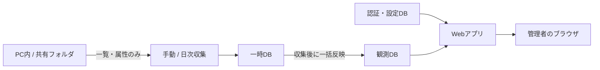

# Tamaru 仕様書

- 対象バージョン: 0.4.0
- 作成日: 2026年10月28日
- 実装の基準: 0.4.0（今回見つからないファイルの表示追加後）

## 1. 目的と利用範囲

Tamaruは、受け渡し用の共有フォルダやPC内のフォルダについて、ファイルの所在・容量・初回検出からの滞留日数を確認するWebアプリである。自分と少数のサーバー管理者が使う便利ツールを想定する。

調査対象のファイル内容は読まず、一覧と属性を取得する。対象ファイルの削除・移動・編集、内容による分類、ディスクの空き容量監視は行わない。内部に将来用の削除処理はあるが、0.3.0では実行経路がなく、設定・環境変数・起動引数からも有効化できない。

利用手順は[操作・運用手順書](OPERATION_GUIDE.md)、LAN向けの設置詳細は[設置手順](DEPLOYMENT.md)、実施済みの検証は[確認結果](VALIDATION.md)を参照する。

## 2. 構成と起動方法

Python / FastAPI / Uvicorn / SQLiteと、HTML・CSS・JavaScriptで構成する。Windows向けEXEはPythonを同梱するため、利用PCへのPythonのインストールは不要。

| 項目       | ローカル利用                               | 社内LAN利用                                 |
| ---------- | ------------------------------------------ | ------------------------------------------- |
| 起動       | EXEを引数なしで起動、または`local`         | `serve`                                     |
| 待受       | `127.0.0.1`固定                            | `--host`で指定。既定は`127.0.0.1`           |
| 既定ポート | 8765                                       | 8765                                        |
| 通信       | このPCからのHTTP                           | HTTPS。直接終端または信頼するプロキシで終端 |
| 初期管理者 | 未登録ならコンソールで登録                 | 事前に`create-admin`で登録                  |
| ブラウザ   | 起動準備完了後に開く。`--no-browser`で抑止 | 手動でアクセス                              |

サーバーは1プロセス・1 workerで動かす。同じ管理データを使う複数起動はロックで拒否する。管理データは実行PCのローカルディスクに保存し、各PCからSQLiteを直接共有して開く構成には対応しない。

## 3. 対象フォルダと収集

- 対象は絶対パスまたはUNCパスで指定する。設定は最大100件。
- 対象の親子重複、ツール本体・管理データと重なる対象は登録できない。
- 指定した対象の配下を再帰的に確認する。隠しファイルも含める。
- シンボリックリンク・ジャンクション・その他の再解析ポイントはたどらない。対象パスの祖先に含まれる場合も収集エラーとする。
- 空フォルダは記録・表示しない。容量は通常ファイルの論理サイズの合計であり、ディスク占有量ではない。
- 共有に接続する資格情報は、Tamaruのプロセスを実行するWindowsアカウントのものを使う。Webのログインユーザーごとに共有への権限が変わる仕組みではない。
- 対象から外したフォルダの記録は保持するが、通常の一覧・集計からは除外する。

収集は本番の観測DBを一時DBへコピーして実施し、処理終了後に観測DBへ一括反映する。収集中は前回の結果を閲覧できる。走査中に例外で失敗した場合は、一時DBの途中結果を公開しない。一覧・階層表示・サマリーの関連SELECTは、同一の読み取りトランザクションで取得する。

対象内に読み取りエラーがある回は、その対象で見つからなかった既存ファイルを一括で消失扱いにしない。確認できたファイルは更新し、それ以外は前回の容量・日時を保持して「未確認」とする。

## 4. ファイルの識別と滞留日数

識別単位は「対象フォルダ＋正規化したフルパス」。ファイル内容やファイルIDによる同一性判定は通常の収集では行わない。

| 発生したこと                                         | 初回検出日時・滞留日数の扱い         |
| ---------------------------------------------------- | ------------------------------------ |
| 初めて検出                                           | その収集の開始時刻を起点に0日から    |
| 同じパスで編集・上書き・別ファイルに置き換え         | 継続                                 |
| 名前変更・別の場所へ移動                             | 新しいパスとして0日から              |
| エラーのない収集で消失を確認し、後で同じパスに再出現 | 0日から                              |
| 収集と収集の間で削除・再配置                         | 検出できず、日数が継続する場合がある |

滞留日数は`max(0, floor((現在時刻 − 初回検出日時) / 86400))`で計算する。元ファイルの更新日時や作成日時は起点にしない。「30日以上」は確認の目安であり、削除条件として使用しない。

通常は収集開始時点の時刻をその回の初回検出・最終確認の記録に使う。表示上の日時は閲覧PCのタイムゾーン、CSVの日時はサーバーのタイムゾーンのオフセット付きで出力する。

## 5. 画面と検索

| 表示・操作           | 動作                                                                                       |
| -------------------- | ------------------------------------------------------------------------------------------ |
| 全体の集計           | 設定中の全対象について、記録中の件数・容量・30日以上の件数・最長滞留日数・未確認件数を表示 |
| フォルダをたどる     | 初期表示。対象フォルダから子フォルダへ1階層ずつ進む                                        |
| フォルダの行         | 配下全体の件数・容量・最長滞留日数・未確認件数を表示                                       |
| ファイルの行         | 現在のフォルダ直下のファイルを表示                                                         |
| パンくず             | 親階層や、すべての対象フォルダへ戻る                                                       |
| この配下の全ファイル | 現在の対象・フォルダを保ち、配下全階層のファイル一覧へ切り替える                           |
| 全ファイル一覧       | 対象フォルダと階層の選択を解除して、全対象のファイル一覧へ切り替える。検索・日数条件は保持 |
| 検索                 | ファイル名を含むパスの部分一致                                                             |
| 日数条件             | すべて、7・14・30・60・90日以上                                                            |
| 並べ替え             | 容量の大きい順、滞留日数の長い順、パス順                                                   |
| ページング           | 画面は100行ずつ。階層表示ではフォルダの行と直下ファイルの行を合わせて数える                |

階層表示ではフォルダを先に表示し、フォルダ同士・ファイル同士をそれぞれ並べ替える。フォルダとファイルを合わせた容量順位ではない。検索・日数条件はフォルダ配下の集計にも適用するが、画面上部の全体集計には適用しない。

画面は約5秒ごとに状態を確認する。一覧取得だけが一時的に失敗した場合は、次回の状態確認で再取得する。表示は最終収集の記録であり、実フォルダの変更を即時に反映するものではない。

### 今回見つからないファイル

「今回見つからない」タブは、各対象の最新の収集で新たに見つからなくなったファイルを表示する。対象が「完了」で、`present=0`かつ`missing_run=roots.latest_run`の記録だけを使う。対象ごとの収集日時と判定状態も表示する。「一部未確認」「中断」の対象は判定せず、エラーの確認と再収集を案内する。収集中は前回公開した結果を表示する。

元のフォルダ、前回確認時の容量、最後に確認した収集、見つからなかった収集の開始日時を表示する。削除・移動・名前変更は区別できず、実際の削除日時や実行者も分からない。前回の収集が一部未確認なら、最後に確認できた時点からの変化となる。初回の収集には比較元がない。

対象フォルダ・パス検索・並べ替え・ページングに対応する。滞留日数の絞り込みは無効にする。一覧は収集ごとに更新し、過去すべての消失を並べる履歴画面にはしない。同じパスに再出現した場合は消失の収集番号を消す。旧DBは起動時に`files.missing_run`のNULL許容整数列を追加し、既存の値を保持する。更新前の消失日時は復元せず、この一覧には含めない。

`/api/list?mode=missing`と`/api/export?mode=missing`へのGETで取得できる。CSVは検索に合う全件を出力し、確認状態と消失を確認した収集の開始日時を含む。容量と滞留日数は最後に確認した時点の値となる。通常のCSVの列は変えない。ファイル全件の日別コピーや新しい履歴テーブルは作らない。

### 日別推移と管理データ容量

既存の収集履歴を使い、日本時間の収集開始日ごとの容量・ファイル数をグラフと表で表示する。期間は30日・90日・365日。対象は現在設定中の全体または対象フォルダ単位で、任意の子フォルダ・ファイル別の過去推移は復元しない。検索・滞留日数・階層表示の条件は推移に適用しない。

同日の最後の正常な結果を採用する。全体は同一の収集開始時刻で現在の対象すべてが正常完了した結果だけを合算する。未収集・正常結果のない一部未確認等は欠測とし、線をつながず0にも置き換えない。正常な結果の後に不完全な収集があれば、正常値を残して注意を表示する。増減は表示期間内の前回正常結果との比較で、間隔の日数も表示する。

管理データの容量は管理DB・収集用一時DB・SQLite補助ファイルに分けて表示する。履歴を削除する操作は提供しない。

## 6. CSV出力

現在の対象・フォルダ配下・検索・日数条件に合う全ファイルを出力する。フォルダの集計行ではなく、ファイルごとの一覧となる。表示ページと画面の並べ替えには限定せず、初回検出日時・パスの順に出力する。

- ファイル名: `Tamaru-files.csv`
- 文字コード: UTF-8、BOM付き
- 列: 対象フォルダ、ファイルの場所、ファイル名、容量(bytes)、滞留日数、初回検出日時、最終確認日時、元の更新日時、確認状態
- 文字列が数式として解釈され得る場合は、先頭に`'`を付けて出力する。

## 7. 手動収集・日次収集と状態

| 項目                               | 仕様                                                           |
| ---------------------------------- | -------------------------------------------------------------- |
| 手動収集                           | 「今すぐ収集」で受付。1日に複数回実行可能                      |
| 日次の初期設定                     | 有効、日本時間02:00（`Asia/Tokyo`）                            |
| 設定変更                           | 画面で日次の有効・無効と時刻を変更。既存のタイムゾーン値は保持 |
| 日次確認                           | 約30秒ごと。指定タイムゾーンの日付ごとに1回受付                |
| 指定時刻を過ぎて起動               | 当日分が未受付なら次の確認周期で受付。過去日分を連続実行しない |
| 他の収集が実行中                   | 手動要求は重複拒否。日次要求は次の確認周期以降に受付を再確認   |
| 日次が失敗・一部未確認             | 同日の自動再試行はしない。手動収集は可能                       |
| 日次が中断                         | 再起動時に中断として記録し、日次受付を再び可能にする           |
| プロセス停止・PCの電源断やスリープ | 収集は動かない                                                 |
| 終了                               | 収集の完了を待つ。収集のキャンセル機能はない                   |

収集結果は「完了」「一部未確認」「失敗」「中断」などで表示する。ファイルの「確認済み」は公開済みの最新収集で確認できた意味であり、閲覧時点の実在を保証しない。

最近の収集は対象フォルダ単位の履歴を全対象合わせて直近20件表示する。最新収集に属するエラーは全対象を合わせて最大100件、操作履歴は最新100件を表示する。画面の表示上限は保存件数の上限ではない。

## 8. 管理者・接続制御

- 初期管理者以外は、画面の「管理者管理」から追加する。全員が同じ権限を持ち、他の管理者の有効・無効やパスワードを変更できる。
- IDは3〜64文字。半角英数字で始まり、以降は半角英数字・`_`・`.`・`-`を使用する。英字の大小は区別しない。表示名は1〜100文字。
- パスワードは12〜256文字。Argon2idでハッシュ化して保存する。既定のパスワードはない。
- セッションはログインから8時間で失効する。無効化・パスワード再設定でもその管理者の既存セッションを失効させる。最後の有効な管理者は無効化できない。
- 管理者の削除、閲覧専用権限、部署別権限、SSO・MFAは提供しない。
- CookieはHttpOnly・SameSite=Strict。HTTPS運用ではSecureを付ける。ログインと状態変更APIにはCSRF対策を行う。
- ログイン失敗はIP・ID別の記録済み回数を基に制限する。15分の期間内に10回以上の記録があれば後続試行を拒否する。並列要求数の厳密な上限を保証する機構ではない。
- `local`はループバック接続のみ。`serve`は通常HTTPS必須で、`--dev-http`を指定した場合もHTTPはループバック接続に限定する。
- LAN接続はプライベート・リンクローカル・ループバックの許可範囲で検査し、Host許可リストも検査する。プロキシの転送ヘッダーは明示した接続元だけを信頼する。
- リクエスト本文の上限は100,000バイト。ファイル名・パスのHTML出力をエスケープし、CSVにも数式対策を行う。

ファイル名・パスを含む管理データ、バックアップ、CSVは管理者が扱う。ネットワーク・ファイルのアクセス権の設定はアプリが自動で行うものではない。

## 9. 保存データと構成ファイル

| ファイル                       | 保存内容                                                                   |
| ------------------------------ | -------------------------------------------------------------------------- |
| `app.sqlite3`                  | 管理者、セッション、日次設定、直近ジョブ・日次受付、ログイン試行、操作履歴 |
| `inventory.sqlite3`            | 対象フォルダ、収集履歴、ファイル観測、収集エラー                           |
| `settings.json`                | 対象フォルダのパス一覧                                                     |
| `staging/`                     | 収集中に使う一時DB・一時設定                                               |
| `server.lock`・`scan.lock`など | 重複起動・収集の排他用。ファイルの存在だけではロック中とは判断しない       |
| `*-wal`・`*-shm`など           | SQLiteが動作中に使用する補助ファイル                                       |

保存先は`--state`で指定する。省略時はEXEではEXEと同じフォルダの`data`、Pythonではカレントフォルダの`data`。収集対象のパスだけでなく、この保存先も引き継がないと観測履歴・管理者設定は引き継がれない。

消失したファイル・収集履歴・操作履歴は自動削除しない。観測DBは収集の前後に全体をコピーするため、本番DBに加えて同程度の一時DBとSQLite補助ファイルの空き容量が必要になる。自動バックアップ機能はなく、停止後に保存先全体をコピーする。

一時DBは収集完了・失敗後と次回起動時に整理する。本番と一時DBの排他を確保し、接続終了後に既知の一時DB・SQLite補助ファイルのみ削除する。リンク・ジャンクション・ロック中の場合は保留し、管理データ容量の欄で通知する。本番の観測記録・収集履歴・操作履歴は削除しない。

## 10. 保守用インターフェース

### コマンド

共通の`--state`はサブコマンドより前に置く。例: `Tamaru.exe --state C:\TamaruData local`。

| コマンド                                | 用途                                                        |
| --------------------------------------- | ----------------------------------------------------------- |
| 引数なし / `local`                      | ローカル起動。`--port`、`--no-browser`を指定可能            |
| `serve`                                 | LAN向け起動。HTTPS証明書または信頼するTLS終端プロキシが必要 |
| `create-admin ID --display-name 表示名` | 初期管理者の登録。登録済みなら拒否                          |
| `reset-password ID`                     | パスワードを対話再設定し、対象を有効化                      |
| `import-folderage コピー元`             | 空の観測先へFolderAgeの初回検出日時と記録を取り込む         |

### 主なAPI

利用者は通常Web画面を使う。以下は保守時の対応表であり、外部システム向けの互換性を保証したAPIではない。

| メソッド・パス                 | 用途                           | 認証・CSRF     |
| ------------------------------ | ------------------------------ | -------------- |
| `GET /api/login-token`         | ログイン用トークン取得         | 未認証で可     |
| `POST /api/login`              | ログイン                       | ログイン用CSRF |
| `GET /api/me`                  | ログイン中の管理者・CSRF取得   | 認証           |
| `POST /api/logout`             | ログアウト                     | 認証＋CSRF     |
| `GET /api/summary`             | 全体集計・履歴・収集状態       | 認証           |
| `GET /api/browse`              | 1階層のフォルダ・直下ファイル  | 認証           |
| `GET /api/list`                | 全ファイル一覧・従来の階層集計 | 認証           |
| `GET /api/export`              | CSV                            | 認証           |
| `GET /api/config`              | 対象・日次設定の取得           | 認証           |
| `POST /api/config`             | 対象・日次設定の変更           | 認証＋CSRF     |
| `POST /api/scan`               | 手動収集の受付                 | 認証＋CSRF     |
| `GET /api/admins`              | 管理者一覧                     | 認証           |
| `POST /api/admins`             | 管理者追加                     | 認証＋CSRF     |
| `PATCH /api/admins/{admin_id}` | 有効状態・パスワード変更       | 認証＋CSRF     |
| `GET /api/audit`               | 操作履歴                       | 認証           |
| `GET /api/deletion/status`     | 常に削除無効の状態を取得       | 認証           |

追加APIは`GET /api/trends`（認証必須。`days`は1〜366、`root`省略は全体）と`GET /api/storage`（認証必須）。日別推移・容量集計は[reports.py](../tamaru/reports.py)、グラフ描画は[reports.js](../tamaru/static/reports.js)で実装する。

## 11. 制約と実装の参照先

実際の共有サーバー、資格情報、証明書、常駐設定での動作は設置先で確認する。ローカルテストの速度をそのまま実環境の速度として扱わない。共有の応答が止まると収集・終了が待ち続ける場合がある。

| 参照先                                 | 内容                               |
| -------------------------------------- | ---------------------------------- |
| [inventory.py](../tamaru/inventory.py) | 観測、日数、検索、階層表示、CSV    |
| [jobs.py](../tamaru/jobs.py)           | 収集の実行管理、日次受付、結果反映 |
| [security.py](../tamaru/security.py)   | 管理者・セッション・試行制限・監査 |
| [web.py](../tamaru/web.py)             | API・入力検証・接続境界            |
| [**main**.py](../tamaru/__main__.py)   | 起動・初回登録・回復・移行         |
| [app.js](../tamaru/static/app.js)      | 画面の移動・絞り込み・状態更新     |
| [削除機能の実装状況](RETENTION.md)     | 無効化の範囲と将来用の内部処理     |
